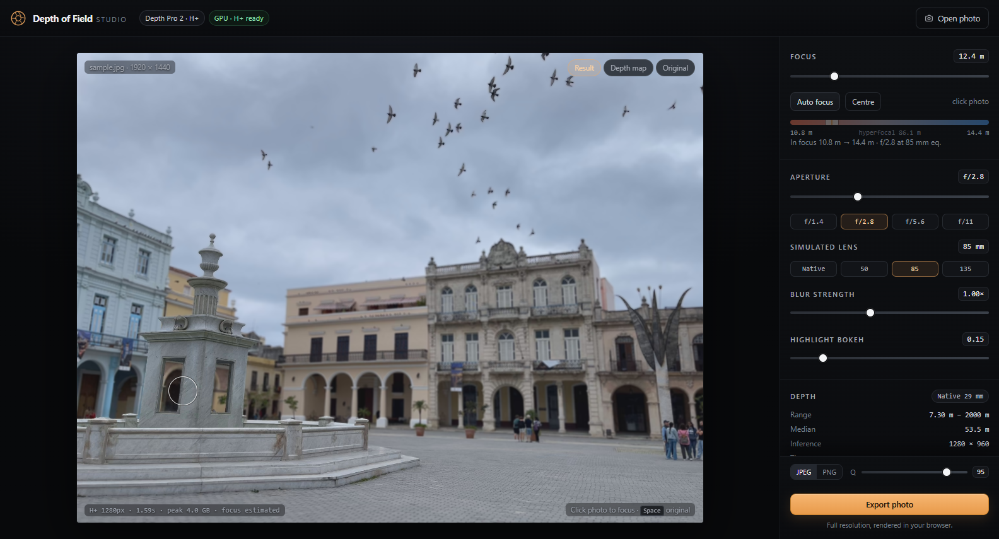

# Depth of Field Studio

Add a real depth of field to any photo, after the fact. Apple's **Depth Pro 2 (H+)**
estimates metric depth — every pixel in metres — and the browser turns that into a
physical lens: pick a focus distance, pick an aperture, and the circle of confusion
follows the thin-lens formula. Nothing is baked in, so you can re-focus the shot
forever.



## Install

Needs **Python ≥ 3.11** and an NVIDIA GPU with ~4 GB free (it runs on CPU too, slowly).

```bat
git clone https://github.com/apple-aiml-research/ml-depth-pro-2.git repo
py -3.13 -m venv venv
venv\Scripts\python.exe -m pip install -r requirements.txt
venv\Scripts\python.exe -m pip install -e ./repo
```

`requirements.txt` pins `torch==2.11.0+cu128` / `torchvision==0.26.0+cu128` from the
CUDA index — plain PyPI wheels are CPU-only, and mismatched torch/torchvision pairs
fail at import with `operator torchvision::nms does not exist`.

The weights download themselves on first run (3.3 GB into `torch_cache/`).

## Run it

```bat
run.bat
```

or

```bat
venv\Scripts\python.exe app.py
```

then open <http://127.0.0.1:7860>.

The first launch downloads the H+ checkpoint (3.3 GB) into `torch_cache/`. Later
launches take ~12 s to build the model on the CPU and hand it to the GPU.

## What it does

| | |
|---|---|
| **Depth** | `apple/DepthPro2-H` (872 M params, bf16) at 1280 px on the GPU, refined to full resolution with a colour-aware guided filter so silhouettes stay aligned with the photo, including chroma edges of equal luminance. ~1.5–2.5 s for a photo, ~4 s for a 27 MP one. |
| **Focus** | Slider, *Auto* (median of the centre), *Centre*, or click anywhere in the photo. Distances are in metres, straight from the model. |
| **Aperture** | f/1.0 → f/22 in third stops. |
| **Lens** | *Native* uses the focal length the model estimates; 50/85/135 mm simulate a longer lens, which is how you get a portrait look out of a wide-angle frame. |
| **Render** | WebGL2 layered bokeh in **linear light**. Premultiplied near/far layers retain real edge coverage; a mip pyramid fills occluded background and pre-filters the blur, so 20 taps stay interactive and 40 taps are enough on export. A fixed nine-blade polygon gives consistent aperture character, with light cat's-eye clipping toward the corners. Near-clipped highlights are expanded back above 1.0 before compositing, then the result is encoded to sRGB. |
| **Export** | Full-resolution JPEG/PNG rendered in the browser, plus the depth map as a PNG. |

The depth-of-field band under the focus slider is the honest lens model
(35 mm-equivalent focal length, 30 µm CoC, hyperfocal distance), so it tells you
what a real lens of that focal length and aperture would do. The blur slider is
explicitly artistic: it scales the circle of confusion without pretending the
optics changed.

## Hardware

Tuned for a 6 GB card. The released weights are float32 (3.3 GB); the app builds
the model on the CPU, casts the encoder and decoder to bf16 (they only ever run
under bf16 autocast anyway) and keeps the depth head and focal estimator in
float32. Inference peaks at 3.96 GB at 1280 px, 4.9 GB at 1536 px
(`set DEPTH_SIDE=1536` to try it). If the card is full it retries at 1024 → 768.

## Layout

```
app.py              FastAPI server: /api/analyze, depth IO, static hosting
static/index.html   UI shell
static/style.css    dark photo-editor styling
static/app.js       WebGL2 DOF shader, controls, export
probe_sizes.py      measures VRAM and latency per inference size
test_backend.py     headless pipeline check (no browser)
cdp_test.py         drives headless Brave over CDP: orientation, depth ordering,
                    aperture/refocus behaviour, export path  -> browser_test.js
cdp_screen.py       screenshots the empty and loaded UI
data/<id>/          cached photo.png + depth.f16 + meta.json (last 8 photos)
```

## Notes

* Depth is metric *for the camera that took the photo* — the model predicts depth
  in metres from a monocular cue, and the absolute scale is approximate on
  unusual scenes (very wide lenses, heavy crops, macro). Relative depth is solid.
* Sky is infinite depth: it gets the maximum blur, which is what you want.

## Licence

The **code** here is MIT — see [LICENSE](LICENSE). Apple's material (the model
weights, the `ml-depth-pro-2` package and the sample photo) is **not** MIT and
stays research-only — see [NOTICE.md](NOTICE.md).

This repository is not a redistribution of Depth Pro 2, and the MIT licence does
not extend to Apple's material:

* **Model weights** — `apple/DepthPro2-H` and `apple/DepthPro2-focal` are
  downloaded at runtime under the
  [Apple Machine Learning Research Model Licence](https://github.com/apple-aiml-research/ml-depth-pro-2/blob/main/LICENSE_MODEL):
  **non-commercial scientific research and academic development only**. Nothing
  in this repo grants rights to those weights or to the `ml-depth-pro-2`
  package.
* **Sample image** — `static/sample.jpg` and the renders in `docs/` come from
  Apple's example photo in that repository and are included only so the "Try a
  sample" button works. Treat them as research-use material, and replace them if
  you redistribute this project.

